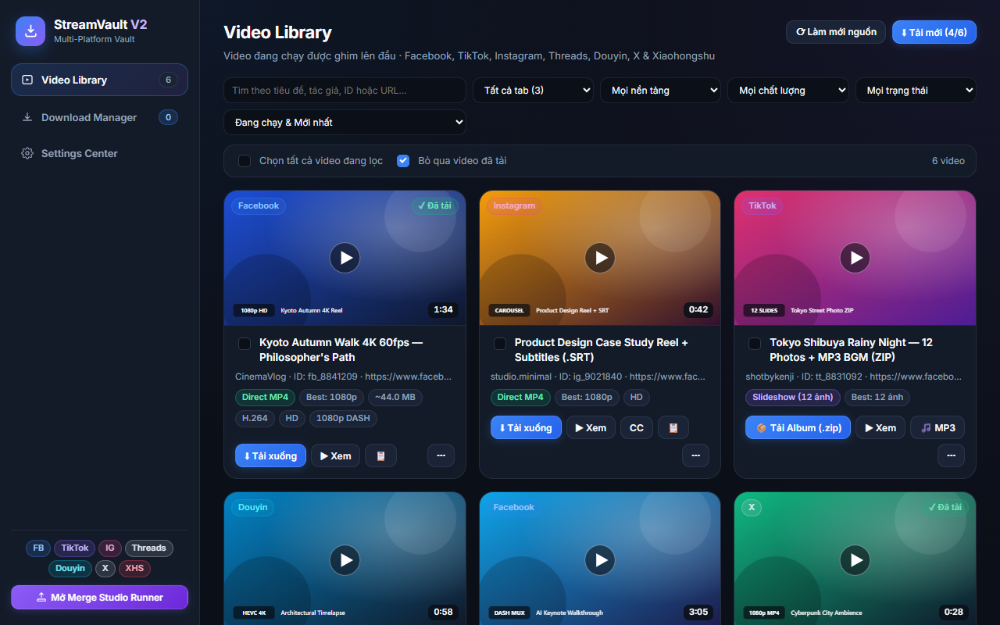
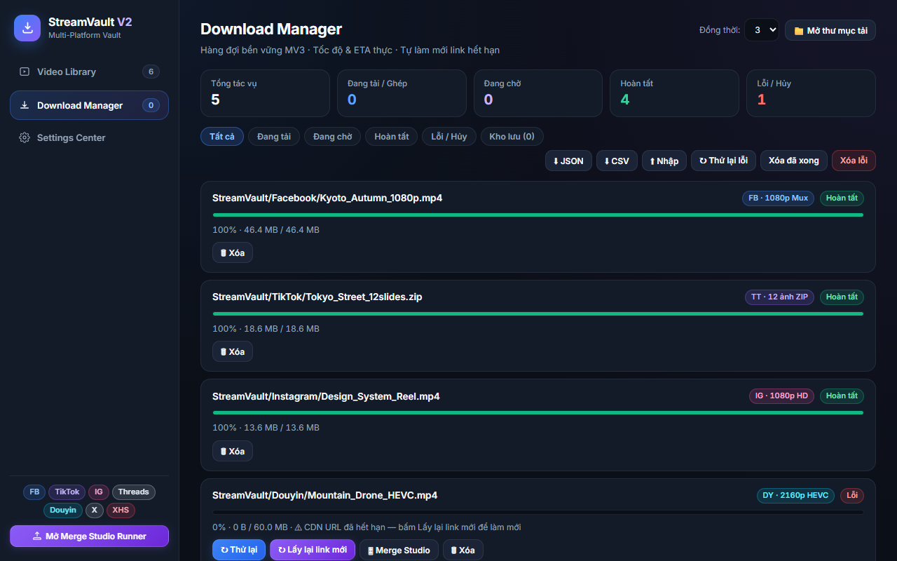
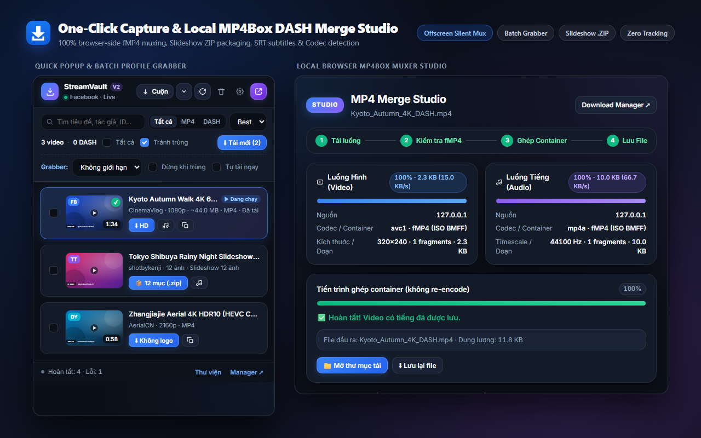
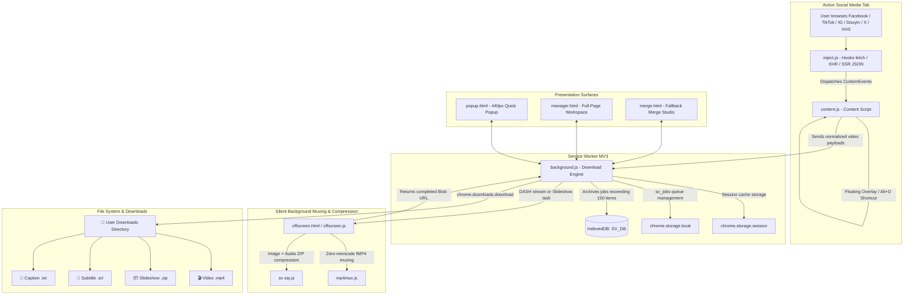

<div align="center">

# ⚡ StreamVault V2 — Multi-Platform Video Vault

### All-in-One Multi-Platform Video, Carousel Album, Story & Subtitle Vault (Manifest V3)

**High-fidelity media extraction from Facebook, TikTok, Instagram, Threads, Douyin, X (Twitter) & Xiaohongshu. Featuring client-side silent fMP4 DASH muxing and pure JavaScript ZIP album packaging.**

[](manifest.json)
[](manifest.json)
[](https://google.com/chrome)
[](https://microsoft.com/edge)
[](PRIVACY_POLICY.md)
[](#-license--disclaimer)

**[🇻🇳 Vietnamese Version](README.md)** • **[🇬🇧 English Version](README.en.md)** • **[🛡️ Privacy Policy](PRIVACY_POLICY.md)** • **[📖 Store Publication Guide](STORE_PUBLICATION_GUIDE.md)**

---



</div>

---

## 📌 Table of Contents

- [🌟 Overview](#-overview)
- [🌐 Supported Platforms Matrix](#-supported-platforms-matrix)
- [🚀 Key Features](#-key-features)
  - [1. Silent Offscreen DASH Muxing](#1-silent-offscreen-dash-muxing-chrome-offscreen-document)
  - [2. Slideshow Album Packaging to .ZIP](#2-pure-javascript-slideshow-album-zip-packaging)
  - [3. HEVC & AV1 Codec Compatibility Alerts](#3-hevc--av1-codec-compatibility-alerts)
  - [4. Native .SRT Subtitles & .TXT Caption Sidecars](#4-native-srt-subtitles--txt-caption-sidecars)
  - [5. Smart Batch Profile Grabber](#5-smart-batch-profile-grabber)
  - [6. Persistent Queue & Long-Term IndexedDB Archiving](#6-persistent-queue--long-term-indexeddb-archiving)
  - [7. Midnight Glass Workspace Experience](#7-midnight-glass-workspace-experience)
- [🖼️ Visual Showcase](#️-visual-showcase)
- [🏗️ Technical Architecture](#️-technical-architecture)
- [📥 Installation Guide](#-installation-guide)
- [⌨️ Keyboard Shortcuts & Quick Actions](#️-keyboard-shortcuts--quick-actions)
- [⚙️ Customizable Path & Filename Templates](#️-customizable-path--filename-templates)
- [📂 Source Code Structure](#-source-code-structure)
- [❓ FAQ & Troubleshooting](#-faq--troubleshooting)
- [🛡️ Privacy, License & Disclaimer](#️-privacy-license--disclaimer)

---

## 🌟 Overview

**StreamVault V2** is an open-source, production-grade Chrome & Microsoft Edge browser extension (Manifest V3) meticulously crafted to discover, parse, preview, and download media content from the world's most popular social networks.

### 💎 Core Architectural Advantages:
- **100% Client-Side Processing:** Operates **completely without intermediary proxy servers**. No target URLs, user credentials, or browsing telemetry are ever transmitted externally. JSON extraction, container muxing, and compression execute strictly in-browser.
- **Zero-Dependency DASH fMP4 Muxing:** Embeds `mp4mux.js` directly within the extension to seamlessly merge separated HD/4K adaptive video and AAC audio tracks without external FFmpeg binary requirements.
- **Midnight Glass Design System:** Designed with modern visual fidelity, utilizing fully self-hosted **Inter** fonts (strict CSP compliance) and seamless **Dark / Light / System** appearance transitions.

---

## 🌐 Supported Platforms Matrix

| Platform | Extraction Scope | Advanced Capabilities |
|:---|:---|:---|
| **Facebook** | Feed, Watch, Reels, Joined Private Groups, Stories | Deep GraphQL / SSR parser, DASH MPD handling (`SegmentTemplate` & `SegmentList`), `captions_url` subtitle extraction. |
| **TikTok** | Short Videos, Photo Slideshow Albums | High-bitrate watermark-free MP4 extraction, bundles multi-photo slideshows + `.mp3` into a single `.zip`, converts `.vtt` to `.srt`. |
| **Instagram** | Feed, Reels, Multi-Item Carousels, Stories & Highlights | Granular item parsing for mixed-slide albums (`carousel_media`), private story archiving, codec identification. |
| **Threads** | Single Posts, Embedded Videos & Media Albums | Unified extractor synchronized with Instagram Graph architecture. |
| **Douyin** | Clean HD Short Videos, Image Collections | Clean non-watermarked `aweme_detail` streams, H.265 stream detection. |
| **X (Twitter)** | Video Tweets, Media cards | Parses `video_info.variants`, automatically selects highest-bitrate stream (up to 1080p), AV1 codec badge. |
| **Xiaohongshu (RED)** | Note Videos, Full-Resolution Photo Galleries | Parses `__INITIAL_STATE__` and note APIs, direct clean MP4 stream acquisition with original gallery downloads. |

---

## 🚀 Key Features

### 1. Silent Offscreen DASH Muxing (Chrome Offscreen Document)
Many modern platforms split high-resolution video (1080p, 2K, 4K) into separate video and audio elementary streams.
- **100% Silent Background Operation:** Leverages the MV3 `chrome.offscreen` API to host `mp4mux.js` in an isolated background context. It reconciles `tfdt` track decode timestamps, merges AAC audio into the video ISO BMFF container, and commits directly to Chrome Downloads **without interrupting your browsing with extra tabs**.
- **Interactive Merge Studio Fallback:** If a non-fragmented or non-standard stream cannot be merged silently, StreamVault automatically opens **MP4 Merge Studio** (`merge.html`) equipped with ready-to-run `ffmpeg` terminal commands.

### 2. Pure-JavaScript Slideshow Album .ZIP Packaging
For posts containing between 10 and 30 slides (TikTok Slideshows, Instagram Carousels):
- StreamVault V2 incorporates `sv-zip.js` (a pure-JS PKZIP Store-method compressor, zero NPM dependencies).
- Compresses all high-res photos alongside the background audio `.mp3` into **one tidy `.zip` file**, preventing clutter in your destination folder.

### 3. HEVC & AV1 Codec Compatibility Alerts
High-fidelity streams frequently adopt **HEVC (H.265 / `hev1`)** or **AV1 (`av01`)**:
- The extension automatically parses codec strings from container descriptors and highlights them with visual tags (`H.264`, `HEVC`, `AV1`).
- Helps creators anticipate editing software compatibility (e.g., Premiere Pro, DaVinci Resolve) or hardware playback limitations before downloading.

### 4. Native .SRT Subtitles & .TXT Caption Sidecars
- **Automated Subtitle Conversion:** Intercepts WebVTT (`.vtt`) subtitle streams, transforms timecodes into standard SubRip format (`00:00:00,000 --> 00:00:02,000`), and saves clean UTF-8 `.srt` files.
- **Metadata Archiving:** Automatically outputs video title, author, original URL, and complete hashtag lists into a paired `.txt` companion file.

### 5. Smart Batch Profile Grabber
Designed for archiving user channels, profiles, and feeds:
- Automatically scrolls pages to capture a targeted count (`10`, `20`, `50`, or `Unlimited`).
- **Stop on Duplicate:** Halts scrolling automatically upon encountering content already recorded in your completed history.
- **Auto-Download:** Option to instantly enqueue new items into the download pipeline upon discovery.

### 6. Persistent Queue & Long-Term IndexedDB Archiving
- **Resilient Engine (`sv_jobs`):** Manages 1–5 concurrent workers, measures real-time throughput and ETA, and persists queue states across browser restarts.
- **One-Click URL Refresh (`refreshUrl`):** When CDN security tokens expire, simply click *↻ Refresh Link*; the extension rescans the original tab to retrieve fresh URLs without a full reload.
- **Long-Term Storage (`IndexedDB`):** Automatically archives completed jobs exceeding 150 entries into `SV_DB`, providing search indexing and **JSON** / **CSV** data export.

### 7. Midnight Glass Workspace Experience
Full-page management at `manager.html` structured into three dedicated workspaces:
- **Video Library:** Visual cards with multi-dimensional filtering (Tab, Platform, Quality, Status) and an inline HTML5 playback preview modal.
- **Download Manager:** Comprehensive job inspection, *📂 Show in folder* actions, error diagnostics, and IndexedDB historical records.
- **Settings Center:** Configurable directory patterns, dynamic filename tokens, theme toggles, and shortcut bindings.

---

## 🖼️ Visual Showcase

<div align="center">

### Comprehensive Video Library


### Download Manager & Queue Controller


### Quick Popup & Interactive Merge Studio


</div>

---

## 🏗️ Technical Architecture



---

## 📥 Installation Guide

### Option 1: Install from Release ZIP (Recommended for Users)
1. Download the latest release package: **[StreamVault-V2-v2.7.0.zip](StreamVault-V2-v2.7.0.zip)**.
2. Extract the `.zip` archive into a persistent folder (e.g., `C:\Tools\StreamVault-V2`).
3. Open Google Chrome or Microsoft Edge:
   - Chrome: Navigate to `chrome://extensions`
   - Edge: Navigate to `edge://extensions`
4. Enable the **Developer mode** toggle in the top-right corner.
5. Click **Load unpacked** and select the extracted folder.
6. Pin the StreamVault icon to your browser toolbar for instant access.

### Option 2: Clone from Git (For Developers)
```bash
# 1. Clone repository
git clone https://github.com/vokhoi220808/StreamVault-V2.git
cd streamvault-v2/fb-video-downloader

# 2. Open chrome://extensions -> Enable Developer Mode
# 3. Select "Load unpacked" and point to the fb-video-downloader directory
```

---

## ⌨️ Keyboard Shortcuts & Quick Actions

| Shortcut / Trigger | Action | Scope |
|:---|:---|:---|
| <kbd>Alt</kbd> + <kbd>D</kbd> | **Instant Download** | Triggers download of the currently hovered or in-view video element. |
| **Hover Video Element** | **Floating Overlay Pill** | Displays an unobtrusive download button on top of active videos (fullscreen supported). |
| **Toolbar Icon Click** | **Quick Popup** | Lists detected media on the active tab, quality variants, and batch collection controls. |
| **Right-Click Context Menu** | **Open Workspace** | Fast access to Video Library or Download Manager. |
| **Click "Refresh Link"** | **Rescan CDN URL** | Automatically rescans the original tab to resolve expired CDN tokens. |

---

## ⚙️ Customizable Path & Filename Templates

Navigate to **Settings Center** within `manager.html` to configure automated file sorting:

### 1. Subfolder Path Patterns (`subfolderName`):
- `StreamVault/{platform}` ➔ e.g., `StreamVault/Facebook/video.mp4`
- `StreamVault/{platform}/{author}` ➔ Categorized by creator/channel
- `StreamVault/{date}` ➔ Organized chronologically by download date

### 2. Filename Variable Tokens (`filenameFormat`):
| Variable Token | Resolved Content | Sample Output |
|:---|:---|:---|
| `{title}` | Post title or caption (sanitized against OS illegal characters) | `Design System Case Study` |
| `{author}` | Creator handle, channel title, or poster ID | `uicraft` |
| `{platform}` | Target social platform identifier | `instagram` |
| `{id}` | Unique internal media identifier | `9021840` |
| `{shortid}` | Last 6 characters of media ID | `021840` |
| `{quality}` | Quality tag or resolution descriptor | `1080p`, `HD`, `ZIP` |
| `{date}` | Current system date in `YYYYMMDD` format | `20261125` |

*Popular Configuration:* `{date}_{platform}_{author}_{title}_{quality}` ➔ `20261125_instagram_uicraft_DesignSystemCaseStudy_1080p.mp4`

---

## 📂 Source Code Structure

```text
fb-video-downloader/
├── manifest.json         # Chrome MV3 manifest, permissions, and host_permissions
├── rules.json            # Declarative Net Request rules enforcing valid CDN Referer headers
├── design-system.css     # Midnight Glass design system, theme variables & [hidden] resets
├── fonts/                # 100% self-hosted Inter (.woff2) fonts complying with strict CSP
│   ├── inter-latin-ext-wght-normal.woff2
│   ├── inter-latin-wght-normal.woff2
│   └── inter-vietnamese-wght-normal.woff2
├── icons/                # Production extension icons (16, 48, 128px)
│   ├── icon16.png
│   ├── icon48.png
│   └── icon128.png
├── sv-core.js            # Foundation core: normalization, settings migration, safeHttpUrl, formatFilename
├── sv-dash.js            # DASH MPD segment collector (SegmentTemplate & SegmentList)
├── sv-zip.js             # Pure-JS PKZIP Store-method compressor (zero dependencies)
├── sv-db.js              # IndexedDB controller managing persistent historical archives
├── parser.js             # Multi-platform parser (Facebook, TikTok, IG, Threads, Douyin, X, XHS)
├── inject.js             # MAIN world script hooking fetch/XHR and inspecting SSR JSON payloads
├── content.js            # Content script controller, floating buttons, Alt+D, auto-scroll engine
├── background.js         # Service worker download dispatcher, URL security validation, routing
├── offscreen.html        # Offscreen document host for intensive background processing
├── offscreen.js          # Controller orchestrating mp4mux.js and sv-zip.js in offscreen context
├── mp4mux.js             # ISO BMFF box manipulation engine (moov, mvhd, trak, tfdt) for fMP4 muxing
├── popup.html / .js / .css  # Compact 440px Popup UI, Batch Grabber, and filter controls
├── manager.html / .js / .css # Full-page Workspace (Video Library, Downloads, Archive, Settings)
├── merge.html / .js / .css   # Interactive MP4 Merge Studio and terminal FFmpeg generator
└── PRIVACY_POLICY.md     # Official Privacy Policy document
```

---

## ❓ FAQ & Troubleshooting

### 1. Why do some Facebook or Instagram videos download without audio?
High-resolution streams (1080p, 2K, 4K) are served as separate video and audio tracks (DASH). StreamVault V2 **automatically merges them silently via an Offscreen Document**. Verify that **"Silent DASH Muxing (Offscreen)"** is enabled in Settings. If a rare container configuration prevents automated muxing, Merge Studio opens with a pre-formatted FFmpeg command.

### 2. How do I download an entire TikTok or Instagram photo carousel?
When an album or slideshow post is identified:
- The Popup or Video Library presents an amber/blue **"Download Album (.zip)"** action.
- StreamVault packs all full-resolution slides along with the background music track into a single `.zip` file automatically.

### 3. How does "Refresh Link" work?
Content delivery networks often enforce URL expiry tokens lasting 2–6 hours. If a queued download reports an expired CDN link, you don't need to re-find the post: simply open the original video page in a browser tab and click **"↻ Refresh Link"** in Download Manager to update the URL and resume.

---

## 🛡️ Privacy, License & Disclaimer

### 🔒 Privacy Commitment (Zero Data Collection)
- StreamVault V2 does **NOT** collect, transmit, or monetize any Personally Identifiable Information (PII).
- **NO** remote scripts or analytics are loaded. Everything runs strictly on your machine.
- Read the complete policy in **[PRIVACY_POLICY.md](PRIVACY_POLICY.md)**.

### ⚖️ Legal Disclaimer
- This extension is intended for personal archiving, backup, and fair-use educational purposes.
- Users are solely responsible for ensuring compliance with copyright laws and the Terms of Service of each respective platform.
- Brand trademarks (Facebook, TikTok, Instagram, Threads, Douyin, X, Xiaohongshu) are the property of their respective owners and are mentioned strictly for descriptive compatibility purposes.

### 📄 License
Distributed under the **MIT License**. You are free to inspect, adapt, and distribute this software provided that original attribution is maintained.
