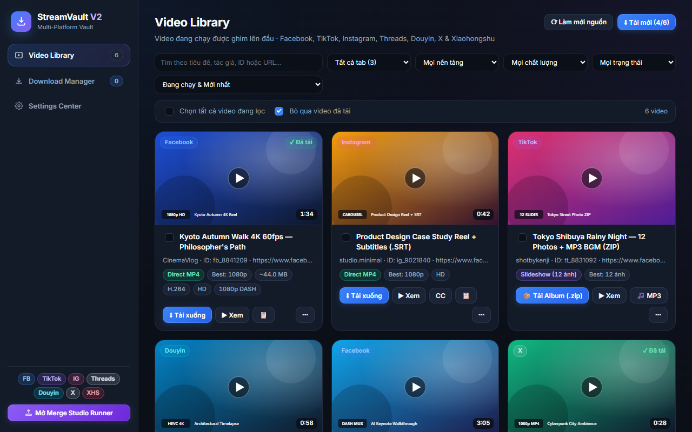
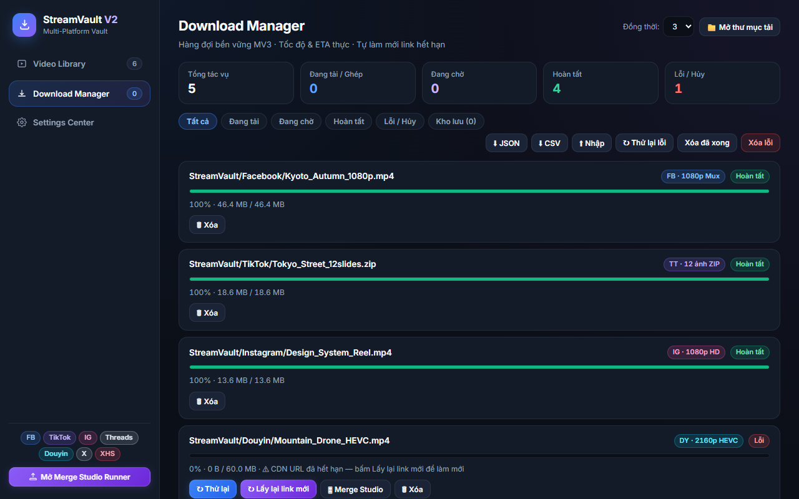
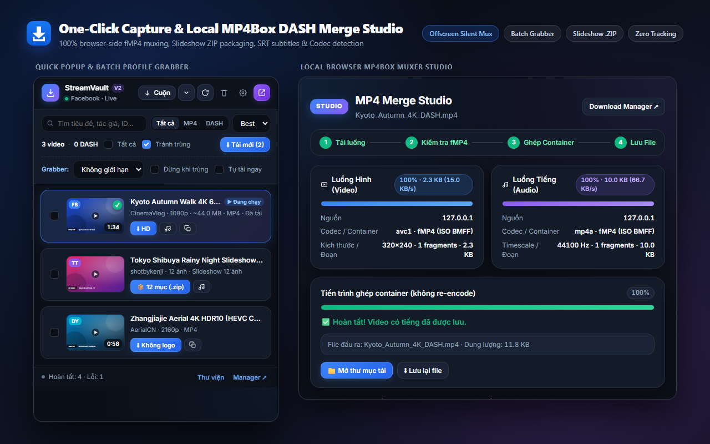
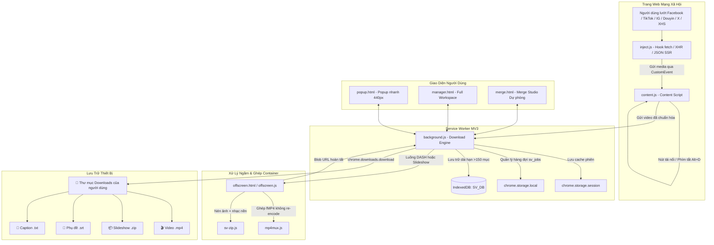

<div align="center">

# ⚡ StreamVault V2 — Multi-Platform Video Vault

### Trình quản lý & Tải Video, Album Carousel, Story, Phụ đề Đa nền tảng (Manifest V3)

**Tải video chất lượng cao từ Facebook, TikTok, Instagram, Threads, Douyin, X (Twitter) & Xiaohongshu. Tích hợp bộ ghép DASH fMP4 ngầm và đóng gói ZIP 100% trong trình duyệt.**

[](manifest.json)
[](manifest.json)
[](https://google.com/chrome)
[](https://microsoft.com/edge)
[](PRIVACY_POLICY.md)
[](#-bản-quyền--giấy-phép)

**[🇻🇳 Bản Tiếng Việt](README.md)** • **[🇬🇧 English Version](README.en.md)** • **[🛡️ Chính sách bảo mật](PRIVACY_POLICY.md)** • **[📖 Hướng dẫn xuất bản Store](STORE_PUBLICATION_GUIDE.md)**

---



</div>

---

## 📌 Mục lục

- [🌟 Giới thiệu tổng quan](#-giới-thiệu-tổng-quan)
- [🌐 Ma trận hỗ trợ 7 nền tảng](#-ma-trận-hỗ-trợ-7-nền-tảng)
- [🚀 Tính năng nổi bật](#-tính-năng-nổi-bật)
  - [1. Ghép DASH ngầm bằng Offscreen Document](#1-ghép-dash-ngầm-bằng-chrome-offscreen-document)
  - [2. Đóng gói Slideshow Album thành file .ZIP](#2-đóng-gói-slideshow-album-thành-file-zip-thuần-js)
  - [3. Cảnh báo Codec HEVC & AV1](#3-cảnh-báo-tương-thích-codec-hevc--av1)
  - [4. Phụ đề gốc .SRT & Caption Sidecar .TXT](#4-tải-kèm-phụ-đề-srt--caption-sidecar-txt)
  - [5. Batch Profile Grabber tự cuộn thông minh](#5-batch-profile-grabber-tự-cuộn-thông-minh)
  - [6. Quản lý tải đa luồng & Kho lưu trữ IndexedDB](#6-quản-lý-tải-đa-luồng--kho-lưu-trữ-indexeddb)
  - [7. Không gian làm việc Midnight Glass Workspace](#7-không-gian-làm-việc-midnight-glass-workspace)
- [🖼️ Giao diện trực quan](#️-giao-diện-trực-quan)
- [🏗️ Kiến trúc kỹ thuật](#️-kiến-trúc-kỹ-thuật)
- [📥 Hướng dẫn cài đặt](#-hướng-dẫn-cài-đặt)
- [⌨️ Phím tắt & Thao tác nhanh](#️-phím-tắt--thao-tác-nhanh)
- [⚙️ Tùy biến mẫu thư mục & Tên file](#️-tùy-biến-mẫu-thư-mục--tên-file)
- [📂 Cấu trúc mã nguồn](#-cấu-trúc-mã-nguồn)
- [❓ Câu hỏi thường gặp & Khắc phục sự cố](#-câu-hỏi-thường-gặp--khắc-phục-sự-cố)
- [🛡️ Bảo mật, Bản quyền & Miễn trừ trách nhiệm](#️-bảo-mật-bản-quyền--miễn-trừ-trách-nhiệm)

---

## 🌟 Giới thiệu tổng quan

**StreamVault V2** là tiện ích mở rộng Chrome/Edge (Manifest V3) mã nguồn mở, được thiết kế chuyên biệt để phát hiện, phân tích, xem trước và lưu trữ nội dung media trực tiếp từ các nền tảng mạng xã hội phổ biến nhất hiện nay.

### 💎 Điểm khác biệt cốt lõi:
- **100% Xử lý nội bộ (Client-Side Only):** Hoàn toàn **không dùng máy chủ trung gian**, không gửi link bài viết ra bên ngoài, không có tracking/telemetry. Mọi tác vụ bóc tách JSON, ghép video DASH và nén file ZIP đều diễn ra bằng CPU của trình duyệt.
- **Ghép DASH fMP4 không cần FFmpeg:** Tích hợp bộ ghép `mp4mux.js` trực tiếp trong tiện ích, xử lý trơn tru các video HD/4K bị tách riêng luồng hình (`video`) và luồng tiếng (`audio`).
- **Giao diện Midnight Glass:** Được xây dựng theo ngôn ngữ thiết kế sang trọng, hiện đại, phông chữ **Inter** nhúng nội bộ chuẩn CSP, hỗ trợ chuyển đổi linh hoạt **Dark / Light / System**.

---

## 🌐 Ma trận hỗ trợ 7 nền tảng

| Nền tảng | Định dạng bóc tách | Tính năng chuyên sâu |
|:---|:---|:---|
| **Facebook** | Feed, Watch, Reels, Nhóm riêng tư đã tham gia, Stories | Bóc tách GraphQL / SSR, ghép DASH MPD (`SegmentTemplate` & `SegmentList`), tải phụ đề `captions_url`. |
| **TikTok** | Video ngắn, Album ảnh Slideshow | Tải MP4 không logo chất lượng cao nhất, đóng gói bộ ảnh + nhạc nền `.mp3` thành 1 file `.zip`, trích xuất phụ đề `.vtt` sang `.srt`. |
| **Instagram** | Feed, Reels, Carousel đa mục, Stories & Highlights | Bóc tách từng slide ảnh & clip con trong album (`carousel_media`), tải Story riêng tư, phát hiện codec. |
| **Threads** | Post đơn, Post đính kèm video / album | Nhận diện media container đồng bộ với kiến trúc Instagram Graph. |
| **Douyin** | Video ngắn không logo, bộ sưu tập ảnh | Lấy luồng `aweme_detail` chuẩn không watermark, cảnh báo video mã hóa chuẩn H.265. |
| **X (Twitter)** | Video Tweet, Media cards | Quét `video_info.variants`, tự động chọn luồng bitrate cao nhất (1080p), cảnh báo codec AV1. |
| **Xiaohongshu** | Video ghi chú, Album ảnh độ phân giải gốc | Đọc state `__INITIAL_STATE__` và API note, tải luồng video trực tiếp không logo kèm danh sách ảnh HD. |

---

## 🚀 Tính năng nổi bật

### 1. Ghép DASH ngầm bằng Chrome Offscreen Document
Nhiều nền tảng (Facebook 1080p/2K/4K, Instagram HD) lưu video dạng phân mảnh DASH: hình ảnh chất lượng cao và âm thanh nằm ở 2 file rời.
- **Xử lý im lặng 100%:** Sử dụng API `chrome.offscreen` tạo tài liệu nền ảo để chạy `mp4mux.js`, tự động tính toán thời gian `tfdt`, ghép audio AAC vào container video MP4 và gửi thẳng vào thư mục Downloads mà **không cần mở thêm tab mới**.
- **Merge Studio Fallback:** Nếu gặp stream đặc biệt không thể ghép tự động, hệ thống mở giao diện tương tác **MP4 Merge Studio** (`merge.html`) kèm câu lệnh `ffmpeg` tạo sẵn để người dùng copy chạy ngay.

### 2. Đóng gói Slideshow Album thành file .ZIP thuần JS
Khi gặp bài đăng chứa 10–30 ảnh (TikTok Slideshow, Instagram Carousel):
- StreamVault V2 tích hợp module nén `sv-zip.js` (chuẩn PKZIP Store thuần JS, không phụ thuộc thư viện ngoài).
- Gom toàn bộ ảnh `.jpg` kèm file âm thanh `.mp3` thành **1 file `.zip` duy nhất**, giữ thư mục Downloads của bạn luôn ngăn nắp.

### 3. Cảnh báo tương thích Codec (HEVC & AV1)
Nhiều video độ nét cao hiện nay được nén bằng chuẩn **HEVC (H.265 / `hev1`)** hoặc **AV1 (`av01`)**:
- Extension tự động phân tích chuỗi codec từ `mimeType` / `Representation` và hiển thị huy hiệu trực quan (`H.264`, `HEVC`, `AV1`).
- Đưa ra cảnh báo tương thích giúp bạn cân nhắc trước khi tải về để dựng phim trên Premiere Pro, Final Cut hoặc xem trên TV/thiết bị cũ.

### 4. Tải kèm Phụ đề (.SRT) & Caption Sidecar (.TXT)
- **Chuyển đổi phụ đề thông minh:** Tự động bắt link phụ đề WebVTT (`.vtt`), chuyển đổi mốc thời gian sang chuẩn SubRip (`00:00:00,000 --> 00:00:02,000`) và lưu thành file `.srt` chuẩn UTF-8.
- **Lưu chú thích bài viết (.txt):** Tự động xuất nội dung tiêu đề, tác giả, đường dẫn gốc và toàn bộ hashtag thành file `.txt` đi kèm video.

### 5. Batch Profile Grabber tự cuộn thông minh
Tiện ích hỗ trợ gom hàng loạt khi bạn duyệt trang cá nhân hoặc kênh:
- Tự động cuộn trang theo số lượng đặt trước (`10`, `20`, `50` hoặc `Không giới hạn`).
- **Dừng khi trùng:** Tự dừng cuộn ngay khi chạm vào video đã có trong lịch sử đã tải, tiết kiệm thời gian và tài nguyên mạng.
- **Tự tải ngay:** Tùy chọn tự đưa vào hàng đợi tải ngay khi vừa quét thấy video mới.

### 6. Quản lý tải đa luồng & Kho lưu trữ IndexedDB
- **Hàng đợi bền vững (`sv_jobs`):** Kiểm soát 1–5 luồng tải đồng thời, đo tốc độ truyền và ETA thời gian thực, tự lưu trạng thái để không bị mất khi đóng trình duyệt.
- **Làm mới link hết hạn (`refreshUrl`):** Khi link CDN của video bị quá hạn (hết hạn sau vài giờ), chỉ cần bấm *↻ Lấy lại link mới*, extension sẽ tự quét lại tab gốc để cập nhật URL mà không cần tải lại trang.
- **Kho lưu trữ dài hạn (`IndexedDB`):** Tự động chuyển các tác vụ hoàn tất vượt quá ngưỡng 150 vào cơ sở dữ liệu `SV_DB`, hỗ trợ tìm kiếm lại lịch sử và xuất file sao lưu **JSON** / **CSV**.

### 7. Không gian làm việc Midnight Glass Workspace
Mở toàn màn hình tại `manager.html` với 3 phân khu chuyên nghiệp:
- **Video Library:** Thư viện xem trước với bộ lọc đa chiều (Tab, Nền tảng, Chất lượng, Trạng thái), hỗ trợ xem video trực tiếp trong modal không cần rời trang.
- **Download Manager:** Quản lý hàng đợi, nút *📂 Hiện file trong thư mục*, xem chi tiết lỗi và kho lưu trữ IndexedDB.
- **Settings Center:** Tự do đặt quy tắc đặt tên file, chọn thư mục lưu con, tùy chỉnh chế độ giao diện và phím tắt.

---

## 🖼️ Giao diện trực quan

<div align="center">

### Không gian quản trị Video Library


### Trình quản lý tiến trình tải Download Manager


### Popup nhanh & MP4 Merge Studio


</div>

---

## 🏗️ Kiến trúc kỹ thuật



---

## 📥 Hướng dẫn cài đặt

### Cách 1: Cài đặt từ gói phát hành ZIP (Dành cho người dùng)
1. Tải gói phát hành mới nhất: **[StreamVault-V2-v2.7.0.zip](StreamVault-V2-v2.7.0.zip)**.
2. Giải nén file `.zip` vào một thư mục cố định trên máy tính của bạn (ví dụ: `C:\Tools\StreamVault-V2`).
3. Mở trình duyệt Chrome hoặc Microsoft Edge:
   - Trên Chrome: Truy cập `chrome://extensions`
   - Trên Edge: Truy cập `edge://extensions`
4. Bật công tắc **Developer mode (Chế độ dành cho nhà phát triển)** ở góc trên bên phải.
5. Nhấn nút **Load unpacked (Tải tiện ích đã giải nén)** và chọn thư mục vừa giải nén.
6. Ghim icon tiện ích lên thanh công cụ trình duyệt để sử dụng.

### Cách 2: Cài đặt từ mã nguồn Git (Dành cho lập trình viên)
```bash
# 1. Clone repository về máy
git clone https://github.com/vokhoi220808/StreamVault-V2.git
cd streamvault-v2/fb-video-downloader

# 2. Mở trình duyệt Chrome -> chrome://extensions -> Bật Developer Mode
# 3. Chọn "Load unpacked" và trỏ vào thư mục fb-video-downloader
```

---

## ⌨️ Phím tắt & Thao tác nhanh

| Thao tác | Cách thực hiện | Mô tả |
|:---|:---|:---|
| **Tải video đang xem** | <kbd>Alt</kbd> + <kbd>D</kbd> | Tự động kích hoạt tải video đang phát dưới con trỏ chuột hoặc video đang hiển thị trên màn hình. |
| **Nút tải nổi trên video** | Di chuột vào video | Xuất hiện nút tải nhỏ gọn ở góc video (hỗ trợ cả chế độ xem Fullscreen). |
| **Mở Popup nhanh** | Bấm icon trên Toolbar | Xem danh sách video trên tab hiện tại, tải từng video, chọn chất lượng hoặc bật Auto Grab. |
| **Mở Workspace** | Bấm *Thư viện* trong Popup hoặc chuột phải vào icon | Mở trang quản trị toàn diện: Video Library, Download Manager và Cài đặt. |
| **Làm mới link hết hạn** | Bấm *↻ Lấy lại link mới* trên dòng lỗi | Tự động quét lại bài viết gốc để cập nhật URL CDN mới mà không mất công tìm lại bài. |

---

## ⚙️ Tùy biến mẫu thư mục & Tên file

Vào **Settings Center** trong `manager.html` để cấu hình quy tắc lưu file tự động:

### 1. Mẫu thư mục con (`subfolderName`):
- `StreamVault/{platform}` ➔ Ví dụ: `StreamVault/Facebook/video.mp4`
- `StreamVault/{platform}/{author}` ➔ Phân loại theo từng tác giả/kênh
- `StreamVault/{date}` ➔ Phân loại theo ngày tải

### 2. Mẫu tên file (`filenameFormat`):
Bạn có thể kết hợp tùy ý các biến động:
| Biến | Ý nghĩa | Ví dụ |
|:---|:---|:---|
| `{title}` | Tiêu đề hoặc dòng chú thích bài viết (tự loại ký tự cấm của OS) | `Review cong nghe` |
| `{author}` | Tên kênh, tác giả hoặc ID người đăng | `tech_reviewer` |
| `{platform}` | Tên nền tảng (`facebook`, `tiktok`, `instagram`, ...) | `tiktok` |
| `{id}` | Mã định danh duy nhất của video | `71982736412` |
| `{shortid}` | 6 ký tự cuối của ID video | `36412` |
| `{quality}` | Nhãn chất lượng hoặc độ phân giải | `1080p`, `HD`, `ZIP` |
| `{date}` | Ngày hiện tại theo định dạng `YYYYMMDD` | `20261125` |

*Ví dụ cấu hình phổ biến:* `{date}_{platform}_{author}_{title}_{quality}` ➔ `20261125_tiktok_kenji_TokyoNight_1080p.mp4`

---

## 📂 Cấu trúc mã nguồn

```text
fb-video-downloader/
├── manifest.json         # Khai báo chuẩn Chrome MV3, permissions & host_permissions
├── rules.json            # Rule Declarative Net Request cấu hình Referer hợp lệ cho CDN
├── design-system.css     # Thiết kế Midnight Glass, bảng màu, biến CSS & reset [hidden]
├── fonts/                # Phông chữ Inter (.woff2) nhúng cục bộ 100% tuân thủ CSP
│   ├── inter-latin-ext-wght-normal.woff2
│   ├── inter-latin-wght-normal.woff2
│   └── inter-vietnamese-wght-normal.woff2
├── icons/                # Icon tiện ích các kích thước chuẩn 16, 48, 128px
│   ├── icon16.png
│   ├── icon48.png
│   └── icon128.png
├── sv-core.js            # Lõi xử lý: chuẩn hóa video, di trú settings, safeHttpUrl, formatFilename
├── sv-dash.js            # Bộ xử lý ghép đa phân đoạn DASH MPD (SegmentTemplate & SegmentList)
├── sv-zip.js             # Bộ nén PKZIP Store thuần JavaScript (không dùng thư viện ngoài)
├── sv-db.js              # Cơ sở dữ liệu IndexedDB quản lý kho lưu trữ lịch sử tải dài hạn
├── parser.js             # Parser đa nền tảng (Facebook, TikTok, IG, Threads, Douyin, X, XHS)
├── inject.js             # Script tiêm vào MAIN world để hook fetch, XHR và đọc JSON SSR
├── content.js            # Content script điều phối, nút tải nổi, phím tắt Alt+D, auto-scroll
├── background.js         # Service worker điều phối hàng đợi tải, kiểm tra scheme, routing
├── offscreen.html        # Khung chứa Offscreen Document chạy tác vụ nặng ở nền
├── offscreen.js          # Controller điều khiển mp4mux.js và sv-zip.js trong Offscreen
├── mp4mux.js             # Bộ xử lý cấu trúc ISO BMFF (moov, mvhd, trak, tfdt) để ghép fMP4
├── popup.html / .js / .css  # Giao diện Popup nhanh (440px), Batch Grabber & bộ lọc
├── manager.html / .js / .css # Workspace toàn trang (Video Library, Downloads, Archive, Settings)
├── merge.html / .js / .css   # MP4 Merge Studio tương tác trực quan & hiển thị lệnh FFmpeg
└── PRIVACY_POLICY.md     # Bản chính sách quyền riêng tư chi tiết
```

---

## ❓ Câu hỏi thường gặp & Khắc phục sự cố

### 1. Tại sao video tải về từ Facebook hoặc Instagram bị mất tiếng?
Nhiều video độ phân giải cao (1080p, 2K, 4K) được mạng xã hội phân tách thành 2 luồng hình và tiếng riêng (DASH). StreamVault V2 sẽ **tự động ghép ngầm qua Offscreen Document**. Hãy đảm bảo bạn đã bật tùy chọn **"Tự động ghép DASH ngầm (Offscreen)"** trong Settings. Nếu gặp video có định dạng âm thanh không tương thích, Merge Studio sẽ tự động mở ra kèm lệnh FFmpeg mẫu để bạn hoàn tất ghép trong 1 giây.

### 2. Làm thế nào để tải toàn bộ bài đăng dạng album ảnh của TikTok hoặc Instagram?
Khi bài đăng là dạng Slideshow nhiều ảnh:
- Trên Popup hoặc Video Library sẽ xuất hiện nút **"Tải Album (.zip)"**.
- Tiện ích sẽ gom toàn bộ ảnh gốc kèm file nhạc nền vào 1 file `.zip` và tự động lưu về máy.

### 3. Nút "Lấy lại link mới" hoạt động như thế nào?
Link CDN từ Facebook hay TikTok thường có token bảo mật hết hạn sau 2–6 giờ. Nếu tác vụ bị lỗi do link hết hạn, bạn không cần phải tìm kiếm lại bài viết: chỉ cần mở bài viết đó trong 1 tab trình duyệt và bấm **"↻ Lấy lại link mới"** trong mục Download Manager, tiện ích sẽ tự bắt URL mới và tiếp tục tải.

---

## 🛡️ Bảo mật, Bản quyền & Miễn trừ trách nhiệm

### 🔒 Cam kết Quyền riêng tư (Zero-Data Collection)
- StreamVault V2 **KHÔNG** thu thập bất kỳ thông tin nhận dạng cá nhân nào (PII).
- **KHÔNG** sử dụng mã từ xa (No Remote Code) — 100% mã nguồn, font chữ và thư viện được đóng gói cục bộ.
- Xem toàn văn chính sách tại **[PRIVACY_POLICY.md](PRIVACY_POLICY.md)**.

### ⚖️ Tuyên bố Miễn trừ trách nhiệm (Disclaimer)
- Tiện ích mở rộng này được phát triển nhằm mục đích phục vụ sao lưu cá nhân và nghiên cứu kỹ thuật.
- Người dùng chịu hoàn toàn trách nhiệm về việc tuân thủ bản quyền, quyền sở hữu trí tuệ và điều khoản dịch vụ của từng nền tảng nội dung liên quan.
- Tên các thương hiệu (Facebook, TikTok, Instagram, Threads, Douyin, X/Twitter, Xiaohongshu) thuộc quyền sở hữu của các tổ chức tương ứng và chỉ được đề cập tại đây nhằm mục đích mô tả tính tương thích.

### 📄 Giấy phép (License)
Phát hành theo giấy phép **MIT License**. Bạn được tự do sử dụng, chỉnh sửa và phân phối lại mã nguồn với điều kiện giữ nguyên thông tin bản quyền gốc.
